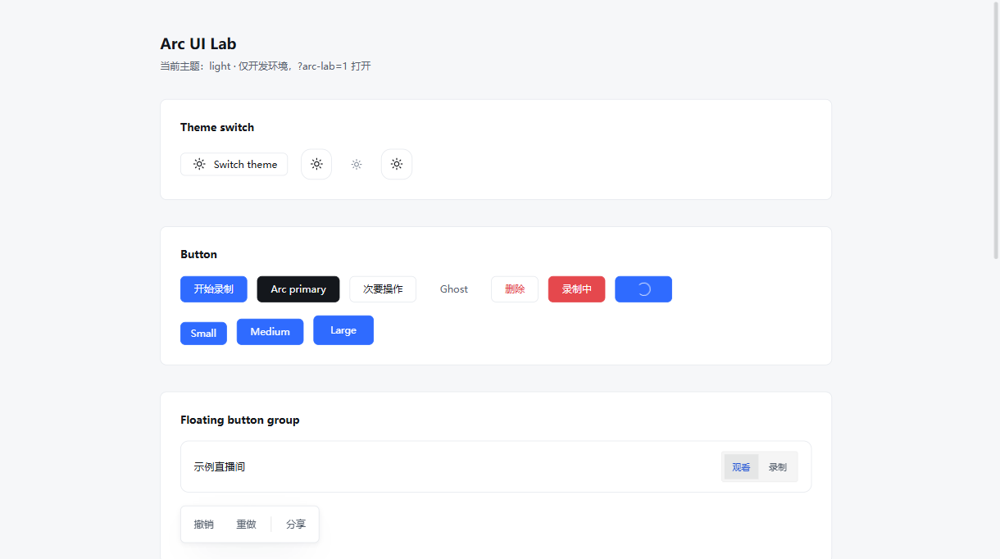

# 95-监控行浮动按钮组

> 状态：v1 已实施（2026-11-09）；浏览器预览完成 ArcLab 与悬浮/录制态验收，Tauri 有数据状态待补。
> 范围：监控列表每行的「观看 / 录制」按钮改成 Arc（uiarc.dev）`FloatingButtonGroup`，共享高亮在按钮之间滑动。
> 前置阅读：`86-Arc-UI控件环境.md`、`94-按钮统一为Arc-Button.md`、`92-四页结构统一.md`。

## 0. 结论速览

- 新增 `src/components/arc/floating-button-group/` 与它依赖的 `src/components/arc/tooltip/`，依赖 `@radix-ui/react-tooltip`。
- 监控行不再放两个独立 Arc Button，而是一个 `muted / sm` 的浮动按钮组：观看、录制两个软按钮共用一块高亮。
- 鼠标在按钮间移动时高亮按 `spring.morph` 滑动并改变宽度；指针离开托盘淡出；按下时高亮加深并缩到 96.5%，按钮本体不缩放。
- 本地扩展两个 item 字段：
  - `loading`：操作进行中，按钮保持原宽度并显示 spinner；
  - `tone`：观看用强调色文字，录制中「停止」用红色文字。
- 录制状态通过 `reserveLabels: ["录制", "停止"]` 预留宽度，切换文案不会把托盘撑开。
- 每行仍只有一个「更多」按钮在托盘外；行内 loading 由 `busyAction` 控制，整行不再变暗。

## 1. 组件与依赖

| 文件 | 作用 |
| --- | --- |
| `src/components/arc/floating-button-group/floating-button-group.tsx` | Arc 源码 + `loading` / `tone` 扩展 |
| `src/components/arc/floating-button-group/floating-button-group.module.css` | 托盘、共享高亮、按压、tone 与 spinner |
| `src/components/arc/tooltip/tooltip.tsx` | Arc Tooltip，FloatingButtonGroup 的依赖（当前行内没有图标/快捷键，不会弹） |
| `src/features/monitor/MonitorPage.tsx` | 行内接入，紧凑尺寸与 `busyAction` loading |

新增依赖：`@radix-ui/react-tooltip`。

## 2. 行内用法

```tsx
<FloatingButtonGroup
  label={t("monitor.rowActions")}
  variant="muted"
  size="sm"
  style={ROW_ACTION_GROUP_STYLE}
  items={[
    { id: "watch", label: t("monitor.watch"), tone: "accent", loading: watchBusy, onSelect: openWatch },
    {
      id: "record",
      label: isRecording ? t("monitor.stop") : t("monitor.rec"),
      reserveLabels: [t("monitor.rec"), t("monitor.stop")],
      tone: isRecording ? "danger" : "default",
      disabled: !room.isLive && !isRecording,
      loading: recordBusy,
      onSelect: toggleRecording,
    },
  ]}
/>
```

- 托盘外的「更多」仍是原来的图标菜单，不并入按钮组。
- 操作列固定 148px：默认 `sm` 在英文 `Watch / Record` 下会略宽，用本地 CSS 变量再收紧一档（28px 高、8px 横向内边距、2px 间隙、8px 外圆角 / 6px 内圆角）。
- 中文标签下托盘约 94px，英文约 110px，加上「更多」仍能放进操作列。

## 3. 动效

- **共享高亮**：一个 `motion.span` 在托盘内绝对定位，位置/尺寸用 motion values 驱动，hover 或键盘焦点移动时按 `spring.morph` 滑动。
- **首次出现**：从 94% 放大落位，不从上一个按钮飞过来。
- **按压**：高亮加深到 12% foreground 并缩到 96.5%；按钮本体不缩放，邻居和 tooltip 锚点保持不动。
- **离开**：原生 `pointerleave` 监听让高亮在指针离开托盘或经过间隙时淡出，不会卡在最后一个按钮上。
- **键盘**：整个托盘一个 tab stop，方向键在按钮间移动，Home/End 到两端，Enter/Space 执行；焦点也驱动高亮。
- **减少动态效果**：高亮直接落位并短暂淡入，不滑动。
- **loading**：当前动作隐藏标签、显示 12px spinner，幽灵标签继续占宽；另一个按钮保持普通外观，点击由 `busy` 守卫拦截，不触发重复执行。

## 4. 视觉

- 托盘：muted 半透明底 + 发丝边，不抢行内容的注意力。
- 观看：`tone="accent"`，浅色蓝 / 深色琥珀文字，保留主操作提示。
- 录制：默认次要色；录制中切「停止」且 `tone="danger"` 红字，配合缩略图 REC 角标与状态列。
- 顶部表格的「操作」列宽、行高 76px 不变；托盘高约 34px，垂直居中。

## 5. 验证

- ArcLab 新增 Floating button group 段：行内 muted/sm 示例与 floating/md 示例。
- 鼠标从「观看」滑到「录制」：高亮平滑移动并改变宽度；离开托盘后淡出。
- 点击「录制」：文案切到「停止」并变红，托盘宽度不变；再点切回「录制」。
- 浅色下观看为蓝字、录制中为红字；深色下跟随琥珀/红色。
- 组件尺寸实测：按钮 42×30（中文），托盘约 94×38；行内紧凑变量会再收窄。
- `pnpm exec tsc -b`、`pnpm build` 通过；`check:i18n` 628 keys、`check:docs` 96 files。





## 6. 已知限制

- **两个动作都变成软按钮**：托盘内不再有蓝色实心主按钮；观看靠强调色文字维持主次，若后续需要更强的主动作，可给 item 加 `tone="primary"` 的填充样式，而不是退回两个独立 Button。
- **紧凑尺寸是本项目覆盖**：通过 `style` 上的 `--fbg-*` 变量实现，仅用于监控行；若其它地方也用，建议在 Arc 组件里增加 `xs` size。
- **`loading` / `tone` 是本地扩展**：重新执行 `shadcn add --overwrite` 会覆盖，需保留。
- **共享高亮依赖真实布局测量**：行内表格列宽变化后 ResizeObserver 会跟随；如果未来把按钮组放进 transform 容器，需要复验高亮对齐。
- **Tauri 有数据状态待补**：浏览器预览没有房间列表，行内真实 hover/录制/loading 需在 `pnpm tauri dev` 下再点。
