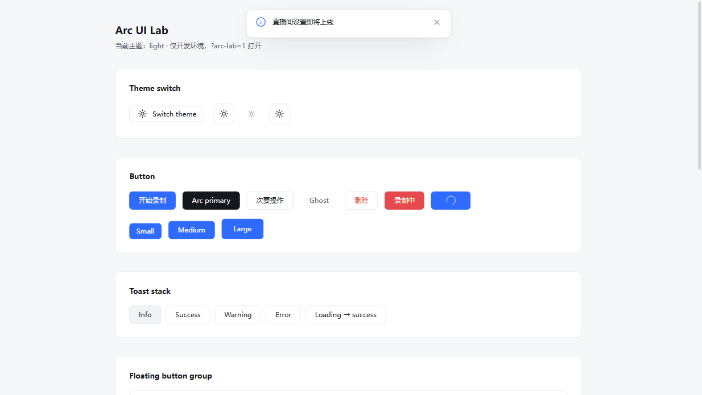
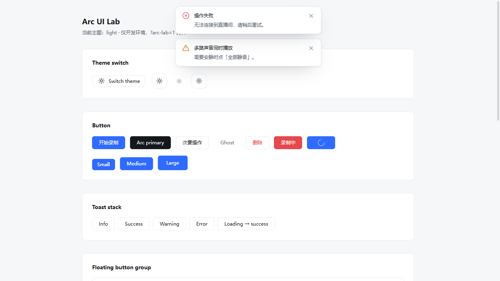
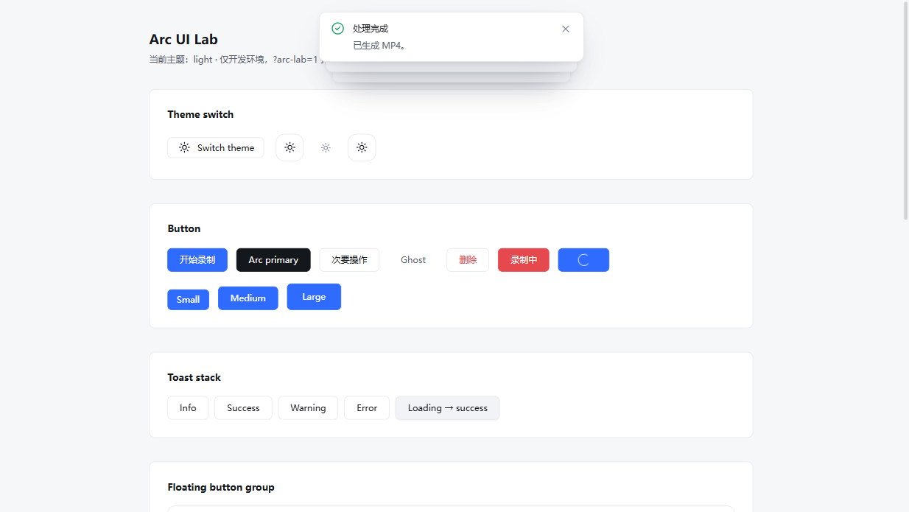
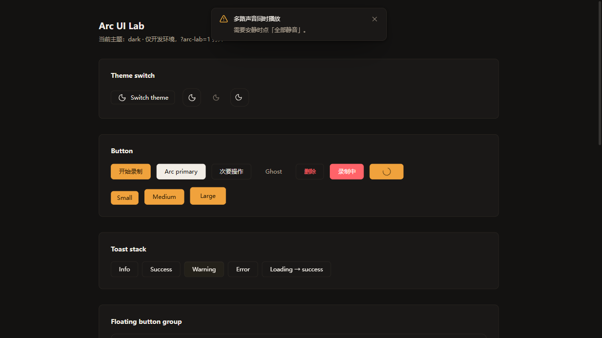

# 96-统一顶部 Toast 提示

> 状态：v1 已实施（2026-11-09）；浏览器预览完成顶部位置、堆叠、展开与 loading→success 验收，Tauri 有数据状态待补。
> 范围：页面内的提示、错误、异常、成功结果统一收进 Arc（uiarc.dev）`ToastStack`，固定在整个界面顶部中间。
> 前置阅读：`86-Arc-UI控件环境.md`、`92-四页结构统一.md`、`95-监控行浮动按钮组.md`。

## 0. 结论速览

- 新增 `src/components/arc/toast-stack/`，并在 `main.tsx` 外层挂 `ToastStackProvider`，`App` 内只渲染一次 `<ToastStack position="top-center" />`。
- Arc 原组件只支持底部位置；本地新增 `top-center`：viewer 固定在 `top: 16px`、`z-index: 80`，toast 从上方落入，收起时向上缩，tuck 时从下边缘露出 14px peek。
- 新增 `src/lib/notify.ts` 的 `useNotify()`：统一提供 `error / warning / info / success`，内部转成 toast；错误用「操作失败」做标题、具体信息做描述。
- 已转换页面内所有临时提示/错误/异常横条：
  - 监控：错误、移除提示、合并结果、多选上限、**「直播间设置即将上线」**；
  - 媒体库：加载/播放/合并/转封装/导出/重试/删除/定位等错误与成功提示；
  - 任务：加载与取消错误；
  - 观看：页面级错误、槽位已满、多路同时发声提示（带「全部静音」action）；
  - 设置：加载/保存/选目录/选 ffmpeg/打开日志/回收站错误，保存成功；
  - 账号：Cookie 保存、退出登录、扫码确认成功，以及登录错误；
  - 应用级：ffmpeg 缺失提示改成不自动消失的 warning toast，带「去设置」action；系统通知事件同时发 OS 通知与顶部 toast。
- 轮询类加载失败在监控、观看、任务里做了去重：连续失败只弹一次，恢复成功后重新允许下一次。
- 保留上下文内的状态：媒体批量处理进度条、播放器槽位错误、账号二维码面板内的过期/错误提示、设置页 ffmpeg/日志字段状态、关闭拦截弹窗，这些不是临时全局提示。

## 1. 组件与位置

| 文件 | 作用 |
| --- | --- |
| `src/components/arc/toast-stack/toast-stack.tsx` | Arc 源码 + `top-center` 位置 |
| `src/components/arc/toast-stack/toast-stack.module.css` | 顶部固定、顶部堆栈方向、z-index 80 |
| `src/lib/notify.ts` | `useNotify` 统一语义入口 |
| `src/main.tsx` | 全局 `ToastStackProvider` |
| `src/App.tsx` | 唯一 `<ToastStack position="top-center" />`，ffmpeg 与系统通知入口 |

位置参数：

```tsx
<ToastStack position="top-center" label={t("toast.region")} />
```

- 宽度 `min(22.5rem, 100% - 32px)`，水平居中；
- `top: var(--space-4)` = 16px；
- `z-index: 80`，高于设置页、回放抽屉、关闭拦截等 `z-50` 层；
- 默认同时显示 3 条，超过的排队；hover / 键盘聚焦时展开，离开后收回；
- Alt+T 可把焦点移入 toast 栈。

## 2. top-center 适配

- `position` 类型新增 `"top-center"`。
- `layoutStack` 增加 `top` 方向：收起时 `y` 为正（向下），展开时以顶部为基准累加高度。
- 进入动画从 `target.y - height` 落入；退出时向上缩 10px。
- `.item[data-top]` 改为 `top: 0; bottom: auto; transform-origin: 50% 100%`。
- 移动端底部居中规则排除 `top-center`，顶部位置在窄屏也保持顶部居中。

## 3. 已转换的提示清单

| 位置 | 原来 | 现在 |
| --- | --- | --- |
| 监控 · 顶部 | `error` 红色横条、`notice` 绿/红横条 | 错误 toast、info/success/warning toast |
| 监控 · 直播间设置 | 「直播间设置即将上线」绿色横条 | info toast「直播间设置即将上线」 |
| 监控 · 多选超限 | 绿色 notice | warning toast |
| 媒体 · 顶部 | `error` 红色横条、`notice` 灰色横条 | 错误/成功/信息 toast |
| 任务 · 顶部 | `error` 红色横条 | 错误 toast，轮询失败去重 |
| 观看 · 顶部 | `error` 红色横条 | 错误 toast |
| 观看 · 多路声音 | 行内浅色提示 + 静音/关闭按钮 | warning toast + 「全部静音」action |
| 设置 · 内容区 | `error` 红色横条 | 错误 toast；保存成功 success toast |
| 账号 · 底部 | `notice` / `error` 文本 | 成功/错误 toast；二维码面板内状态仍保留 |
| 应用 · ffmpeg 缺失 | 顶栏下方黄色横条 | 不自动消失的 warning toast + 「去设置」action |
| 应用 · 系统通知 | 仅 OS 通知 | OS 通知 + 同文案顶部 toast |

## 4. 去重与上下文保留

- **轮询去重**：监控 `rooms://changed`、任务 2 秒轮询、观看槽位刷新失败时，用一个 ref 记录「本轮错误已提示」，成功后复位；避免连续失败每 2 秒刷一条 toast。
- **进度不转 toast**：媒体批量处理 `statusLine` 是进行中的进度，不是结果提示，继续留在工具栏下方。
- **上下文错误不转 toast**：播放器槽位 `session.error`、二维码面板过期/错误、设置页 ffmpeg/日志路径状态、关闭拦截弹窗，都与具体控件绑定，保留原位更可操作。
- **关闭拦截、ErrorBoundary**：是阻断式对话/兜底页，不是短暂提示，保持原样。

## 5. 验证

- 浏览器预览 `?arc-lab=1` 的 Toast stack 段：Info / Success / Warning / Error / Loading→success 五个入口。
- 顶部位置实测：viewport `top=16px`、水平居中、宽 360px；单条时卡片高度约 50px。
- 连续弹 Warning + Error：未悬停时只露出前一条与后方 peek；悬停后向下展开为两条完整卡片。
- Loading toast 在 1.4 秒后原地 morph 成 success，图标、标题、描述和高度平滑过渡。
- 深色主题：卡片使用 `surface-raised`，warning/error/success 图标分别使用警告/危险/成功色。
- `pnpm exec tsc -b`、`pnpm build` 通过；`check:i18n` 631 keys、`check:docs` 97 files。









## 6. 已知限制

- **顶部 toast 会短暂盖住顶栏/页面标题**：这是「整个界面顶部中间」的代价；toast 5 秒（错误 8 秒）自动消失，也可点关闭或右滑。
- **持久警告只提示一次**：ffmpeg 缺失 toast 在问题消失前不会重复弹出；用户关闭后需要重新触发（重启或重新检测）才会再出现。
- **OS 通知与 toast 可能同时出现**：系统通知用于后台提醒，toast 用于前台可见；如果觉得重复，可在设置里按通知类型拆分。
- **上下文状态未迁移**：媒体进度、播放器槽位错误、二维码面板状态等保留原位，避免把可操作的局部问题变成全局噪音。
- **top-center 是本地扩展**：重新执行 `shadcn add --overwrite` 会覆盖 `toast-stack` 与 CSS，需保留。
- **Tauri 有数据状态待补**：录制开始/结束、磁盘不足、登录失效、ffmpeg 缺失等真实事件需要在 `pnpm tauri dev` 下再点。
