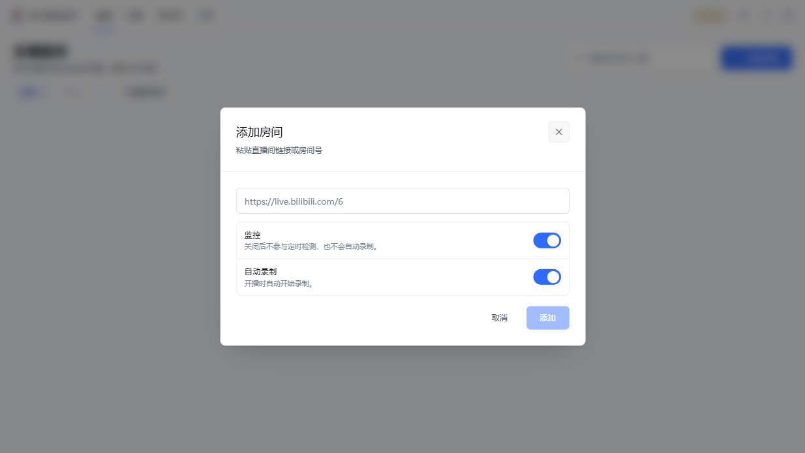
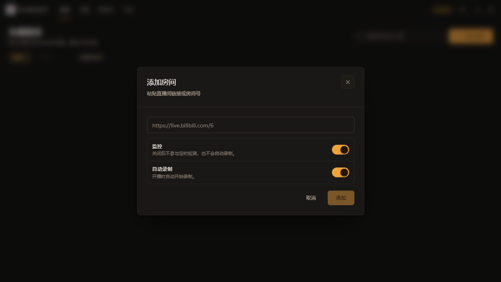

# 97-弹窗统一为 Arc Dialog

> 状态：v1 已实施（2026-11-09）；添加房间弹窗完成浏览器浅色/深色与 Escape/点击遮罩验收，退出拦截与设置丢弃确认待真机补点。
> 范围：应用内居中的模态弹窗统一使用 Arc（uiarc.dev）`Dialog`；侧边抽屉、菜单、Popover 保持原组件。
> 前置阅读：`86-Arc-UI控件环境.md`、`94-按钮统一为Arc-Button.md`、`96-统一顶部Toast提示.md`。

## 0. 结论速览

- 新增 `src/components/arc/dialog/dialog.tsx` 与 `dialog.module.css`，依赖 `@radix-ui/react-dialog`。
- 本地的 `DialogContent` 增加 `size="sm" | "md"`：
  - `sm`：Arc 默认 440px；
  - `md`：560px，用于添加房间这类带输入 + 两个开关的表单。
- 已替换三处居中弹窗：
  - 监控 · 添加房间；
  - 关闭窗口 · 任务拦截 / 可安全退出；
  - 设置 · 放弃未保存更改确认。
- 统一由 Arc Dialog 提供：遮罩、居中面板、标题/说明、右上关闭、焦点陷阱、Escape、点击遮罩关闭、进出场弹簧。
- 侧边抽屉（监控录制详情、媒体回放）、Action 菜单、观看候选浮层、设置全屏页保持原结构；它们不是「居中打断式」弹窗。

## 1. 组件与尺寸

| 文件 | 作用 |
| --- | --- |
| `src/components/arc/dialog/dialog.tsx` | Arc Dialog 源码 + `size` |
| `src/components/arc/dialog/dialog.module.css` | 遮罩、居中、进出场、关闭按钮、`md` 宽度 |
| `src/features/monitor/MonitorPage.tsx` | 添加房间改 `<Dialog>` |
| `src/features/close/CloseDialog.tsx` | 退出拦截改 `<Dialog>` |
| `src/features/settings/SettingsView.tsx` | 放弃更改确认改 `<Dialog>` |

用法：

```tsx
<Dialog open={open} onOpenChange={setOpen}>
  <DialogContent title="添加房间" description="粘贴直播间链接或房间号" size="md">
    <form onSubmit={...}>...</form>
  </DialogContent>
</Dialog>
```

- 受控 `open`：页面状态继续控制开关；
- `onOpenChange(false)` 处理 Escape、右上关闭、点击遮罩；
- 关闭时同步清空输入（添加房间）；
- 弹窗内容在 portal 中挂载，关闭动画结束后卸载。

## 2. 三处转换

### 监控 · 添加房间

- 原来：`fixed inset-0` 手写遮罩 + `w-[560px]` 面板 + 自绘标题/关闭 X。
- 现在：Arc Dialog `size="md"`，标题「添加房间」、说明「粘贴直播间链接或房间号」由 `DialogContent` 渲染；表单只保留输入框、监控/自动录制两个开关和取消/添加按钮。
- 打开时输入框自动聚焦；Escape、右上关闭、点击遮罩都会关闭并清空输入。
- 「添加」仍是 `type="submit"`，表单提交逻辑不变。

### 关闭窗口 · 任务拦截

- 原来：手写遮罩 + `w-[min(460px,92vw)]` 面板 + 自定义标题/说明 + 弹窗内 Escape 监听。
- 现在：Arc Dialog；标题/说明随 `ready` 在「任务进行中」和「可以安全退出」之间切换，Arc 的标题 morph 会原地过渡。
- 任务列表、自动退出开关、取消/立即退出/等待退出按钮仍留在 body。
- `busy` 时 `onOpenChange(false)` 被忽略，Escape/关闭 X 不会中断正在进行的退出操作。

### 设置 · 放弃未保存更改

- 原来：`z-[60]` 手写遮罩 + `w-[380px]` 面板。
- 现在：Arc Dialog 默认 440px；标题/说明来自现有 `settings.discardTitle/discardBody`，底部「继续编辑 / 放弃」不变。
- 保存成功仍走顶部 success toast；放弃后回到设置外部。

## 3. 动效与无障碍

- 遮罩淡入 + 7px backdrop blur；面板从下方 8px、96% 缩放弹入，关闭更短、从当前状态收起。
- `prefers-reduced-motion` 只保留透明度淡化。
- Radix 自带焦点陷阱、Escape 关闭、`role="dialog"`、`aria-labelledby` / `aria-describedby`；本组件显式补 `aria-modal="true"`。
- 标题/说明变化时 Arc 用 `SwapText` 原位交叉淡入，不跳高度。
- 右上关闭按钮 32×32，hover 浅底，按下 96%。

## 4. 保留原样的浮层

| 浮层 | 保留原因 |
| --- | --- |
| 监控录制详情、媒体回放 | 右侧 Drawer，需要保持页面上下文；后续可单独接 Arc Drawer |
| 监控行尾 `⋯`、下拉选择 | 锚定菜单，不是模态 |
| 观看候选放置浮层 | 锚定 Popover |
| 设置整页 | 全屏工作区，不是打断式小弹窗 |
| 顶部 Toast | 独立反馈层，不抢焦点 |
| 关闭拦截内的任务列表 | 仍作为 Dialog body，滚动区域不变 |

## 5. 验证

- 浏览器预览添加房间：`role="dialog"`、`aria-labelledby` 指向标题；面板 560px，输入框自动聚焦。
- Escape 关闭：`[role="dialog"]` 数量归零；点击遮罩同样关闭。
- 浅色：遮罩 46% 黑 + 7px blur，面板 `surface-raised`；深色：面板跟随暖黑，输入与开关仍清晰。
- 添加按钮在输入为空时禁用，输入后恢复。
- `pnpm exec tsc -b`、`pnpm build` 通过；`check:i18n` 631 keys、`check:docs` 98 files。
- 退出拦截与设置丢弃确认依赖 Tauri 运行态/未保存状态，需 `pnpm tauri dev` 下补点。





## 6. 已知限制

- **未使用 DialogTrigger**：三处都由页面状态控制 `open`，因此关闭后焦点恢复由 Radix 的默认行为决定；添加房间当前会回到页面而不是精确回「添加房间」按钮。若后续需要严格焦点回归，可把触发按钮包进 `DialogTrigger asChild`。
- **关闭按钮 aria-label 仍是英文**：Arc 默认 `Close dialog`；标题与说明已本地化。
- **`size="md"` 是本地扩展**：重新执行 `shadcn add --overwrite` 会覆盖。
- **侧边抽屉未迁移**：本次只统一居中模态；Drawer 需要另接 Arc Drawer。
