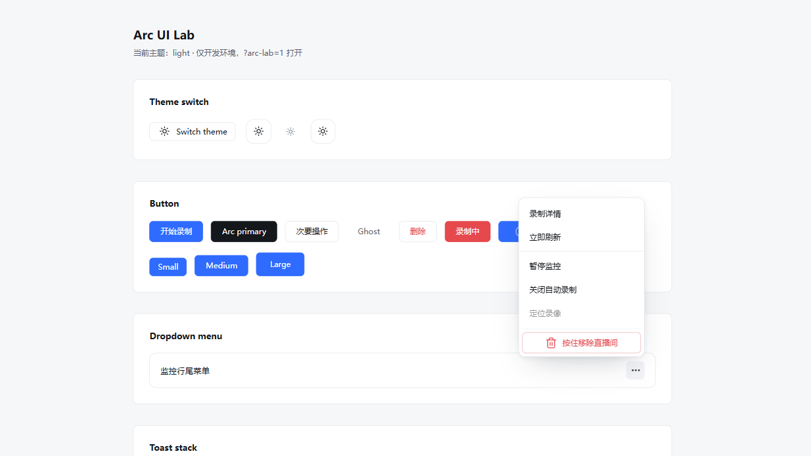

# 98-监控行菜单统一为 Arc DropdownMenu

> 状态：v1 已实施（2026-11-09）；浏览器 ArcLab 完成图标触发器与菜单项验收，删除动作已换成按住确认（见 100），Tauri 有数据状态待补。
> 范围：监控列表每行操作栏的「⋯」菜单从自绘浮层换成 Arc（uiarc.dev）`DropdownMenu`。
> 前置阅读：`86-Arc-UI控件环境.md`、`88-DropdownMenu统一选择菜单.md`、`95-监控行浮动按钮组.md`。

## 0. 结论速览

- 监控行尾「⋯」不再自己画浮层、全屏遮罩和菜单项，改用 `src/components/arc/dropdown-menu`。
- 给 Arc DropdownMenu 补了本地能力：
  - `iconOnly`：只显示图标，隐藏 label 和 chevron，触发器固定 28×28；
  - `footer`：菜单底部自定义区域，用于放删除按钮。
- 菜单项：录制详情、立即刷新、直播间设置、暂停/恢复监控、关闭/开启自动录制、定位录像。
- 删除动作不再做成「移除房间 → 确认移除」二次点击，而是菜单 footer 里的 Arc `HoldToConfirm`「按住移除直播间」；详见 `100-按住确认删除直播间.md`。
- 分隔线、禁用项由 Arc DropdownMenu 的 `separatorBefore / disabled` 表达；危险色由 HoldToConfirm 的 `tone="danger"` 表达。
- 菜单打开时重置删除确认状态，避免下次打开还停在「已移除」。

## 1. 组件扩展

| 能力 | 说明 |
| --- | --- |
| `iconOnly` | 触发器只渲染 icon；`ariaLabel` 作为无障碍名称；不带 chevron |
| `footer` | 菜单项之后渲染自定义内容，带顶部细线；删除用 HoldToConfirm 放在这里 |
| `ariaLabel ?? label` | 图标触发器必须有可读名称 |

图标触发器 CSS：

- `width/min-height: 28px`，`padding: 0`，`justify-content: center`；
- `variant="bare"` 下保持透明底，hover / open 才出现 `surface-muted`；
- 图标颜色跟随 currentColor，和右侧按钮组同一行对齐。

## 2. 监控行接入

```tsx
<DropdownMenu
  label={t("monitor.more")}
  ariaLabel={t("monitor.more")}
  icon={<ThreeDots />}
  iconOnly
  variant="bare"
  size="sm"
  align="end"
  onOpenChange={(open) => { if (open) setRemoveDone(false); }}
  footer={<HoldToConfirm label={t("monitor.holdRemove")} confirmedLabel={t("monitor.removeDone")} tone="danger" duration={1400} confirmed={removeDone} disabled={busy} className="w-full" onConfirm={...} />}
  items={[
    { key: "detail", label: t("monitor.recordDetail"), onSelect: ... },
    { key: "refresh", label: t("monitor.refreshInfo"), onSelect: ... },
    { key: "settings", label: t("monitor.roomSettings"), onSelect: ... },
    { key: "pause", label: ..., separatorBefore: true, onSelect: ... },
    { key: "auto-record", label: ..., onSelect: ... },
    { key: "reveal", label: ..., disabled: !last, onSelect: ... },
  ]}
/>
```

- **删除**：菜单 footer 里是整宽 HoldToConfirm；按住 1.4 秒才执行，提前松手回退。
- **失败恢复**：`removeRoom` 返回成功布尔值；失败时把 `confirmed` 设回 false，同时弹 error toast。
- **禁用**：没有历史录像时「定位录像」禁用，仍保留在菜单里，不隐藏。

## 3. 动效与定位

- 菜单从触发器边缘 5px 偏移、97% 缩放淡入，关闭 130ms；item 有轻微错峰。
- 指针在菜单项之间移动时，一块共享高亮按 snappy 弹簧滑动；键盘焦点即时跳转。
- 菜单自动根据可用空间翻转；ArcLab 里因为下方空间不足，菜单显示在触发器上方。
- 触发器本身不做缩放，避免 Radix 在 pointerdown 时测量到缩放后的锚点。

## 4. 验证

- ArcLab Dropdown menu 段：触发器实测 28×28，无可见 label/chevron；6 个菜单项 + footer 删除按钮。
- 打开菜单：分隔线在「直播间设置」与「暂停监控」之间；「定位录像」禁用；footer 是红色 HoldToConfirm。
- 按住删除按钮：填充推进、提前松手回退、完整按住变「已移除」；详见 `100-按住确认删除直播间.md`。
- `pnpm exec tsc -b`、`pnpm build` 通过；`check:i18n` 640 keys、`check:docs` 101 files。
- 监控真实行的菜单动作依赖房间数据，需 `pnpm tauri dev` 下补点。




## 5. 已知限制

- **菜单可能向上翻转**：行靠近窗口底部时 Radix 会自动改为上方，这是预期行为。
- **删除按钮不是 menuitem**：HoldToConfirm 放在 footer 里，方向键不会落到它；鼠标/触摸按住正常，键盘需先聚焦再按住 Space/Enter。详见 100 的限制。
- **`footer` 是本地扩展**：重新执行 `shadcn add --overwrite` 会覆盖。
- **动作菜单仍是文字项**：未加图标，保持行内菜单紧凑；后续需要可以给 item 加 `icon`。
- **浏览器预览没有房间数据**：真实监控行的菜单定位、录制中文案与定位禁用状态需在 Tauri 下再点。
