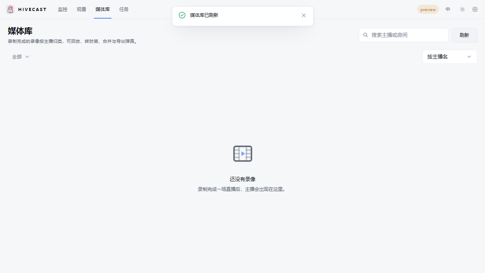
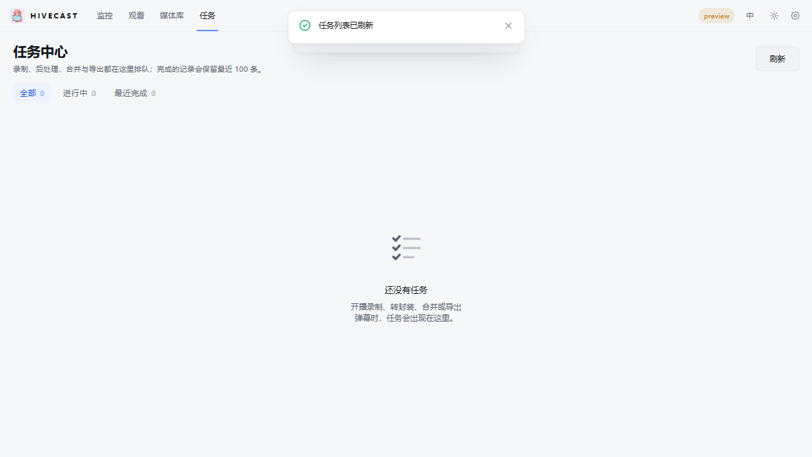

# 99-刷新与按钮反馈补全

> 状态：v1 已实施（2026-11-09）；浏览器预览实测媒体库/任务刷新 toast，监控菜单刷新与自动录制待 Tauri 有数据状态补点。
> 范围：给没有可见结果的刷新动作补 success toast，并审计页面里其它异步按钮的反馈缺口。
> 前置阅读：`96-统一顶部Toast提示.md`、`98-监控行菜单统一为Arc-DropdownMenu.md`。

## 0. 结论速览

- 补了 4 类刷新/确认反馈：
  - 媒体库刷新（主播墙 + 主播页）→ success「媒体库已刷新」；
  - 任务列表刷新 → success「任务列表已刷新」；
  - 监控行「刷新直播间信息」→ success「直播间信息已刷新」；
  - 监控行自动录制开关 → success「已开启/已关闭自动录制」。
- 另外补了 2 处异步结果：
  - 任务「取消」→ info「已请求取消任务」；
  - 媒体批量「在 Finder 中显示」→ info「已在文件管理器中打开」。
- 刷新动作现在会等实际加载完成再提示：媒体 `loadHosts/loadFiles/refreshAll` 返回成功布尔值，任务 `load` 返回成功布尔值；失败只弹错误 toast，不会误报成功。
- 其余按钮逐项审计，保留「结果本身可见」或「系统窗口已给出反馈」的静默行为，避免把每次点击都变成噪音。

## 1. 新增提示

| 入口 | 触发 | 提示 |
| --- | --- | --- |
| 媒体库 · 主播墙刷新 | 顶部「刷新」 | success「媒体库已刷新」 |
| 媒体库 · 主播页刷新 | 顶部「刷新」 | success「媒体库已刷新」 |
| 任务 · 刷新 | 顶部「刷新」 | success「任务列表已刷新」 |
| 监控 · 行尾「立即刷新」 | 刷新直播间信息 | success「直播间信息已刷新」 |
| 监控 · 行尾自动录制 | 开启/关闭自动录制 | success「已开启/已关闭自动录制」 |
| 任务 · 取消 | 取消运行中任务 | info「已请求取消任务」 |
| 媒体 · 批量显示 | 在 Finder 中显示 | info「已在文件管理器中打开」 |

新增 i18n key：`monitor.refreshed`、`monitor.autoRecordEnabled`、`monitor.autoRecordDisabled`、`media.refreshed`、`media.revealed`、`tasks.refreshed`、`tasks.cancelRequested`。

## 2. 实现细节

- **媒体刷新**：`loadHosts` / `loadFiles` 成功返回 `true`，失败返回 `false`；`refreshAll` 汇总两者；`refreshView` 只在成功时弹 success。
- **任务刷新**：`load` 返回 `boolean`；手动「刷新」调用 `refreshTasks`，成功才提示；2 秒轮询仍静默，失败去重。
- **监控菜单刷新**：`run` 包住 `roomRefresh`，完成后提示 success；失败由 `run` 统一弹 error。
- **自动录制**：`run` 包住 `roomSetAutoRecord`，使用切换前的 `room.autoRecord` 选择「已开启/已关闭」文案。
- **任务取消**：`postCancel` 成功后 info 提示，再刷新任务列表。
- **批量显示**：统计成功打开的数量，至少一个成功才提示；单个失败仍逐条弹错误。
- **toast 去重**：轮询失败仍由 `loadErrorShown` 控制；手动刷新是用户主动操作，允许每次都提示成功。

## 3. 审计结论：保留静默的按钮

| 按钮/动作 | 保留原因 |
| --- | --- |
| 监控 · 开始/停止监控 | 状态列立即变为「已暂停/直播中」，结果可见 |
| 监控 · 开始/停止录制 | 按钮切「停止」、缩略图 REC、状态列变化，结果可见 |
| 监控 · 打开录制文件夹 | 系统文件管理器已打开 |
| 媒体 · 播放/停止/切换主文件/源封装 | 播放器与按钮状态立即变化 |
| 媒体 · 选择/全选/清空选择 | 卡片边框与底部批量条即时变化 |
| 媒体 · 加载更多 / +N 补齐片段 | 新卡片直接出现在列表 |
| 媒体 · 单条/批量删除、转封装、合并、导出、重试 | 已有 toast + 列表刷新 |
| 任务 · 筛选胶囊 | 列表立即过滤 |
| 观看 · 布局/紧凑/全屏/弹幕/静音 | 画面与控件状态立即变化 |
| 观看 · 添加并观看 / 换位 / 移除 / 重试 | 槽位内容与播放状态立即变化 |
| 设置 · 选择目录/选择 ffmpeg | 系统文件选择器与字段路径即时更新 |
| 设置 · 打开日志/回收站 | 系统文件管理器已打开 |
| 设置 · 保存 | 已有 success toast + footer 状态 |
| 账号 · 保存 Cookie/退出/扫码确认 | 已有 success toast |
| 顶栏主题/语言/Tab | 页面立即变化 |

## 4. 验证

- 媒体库点「刷新」：顶部 success「媒体库已刷新」；再切任务点「刷新」→「任务列表已刷新」，两条 toast 正常堆叠。
- 浏览器预览没有 Tauri IPC，刷新走 `isTauri()` 的早退分支，仍返回成功并提示；真实加载失败时会走错误 toast。
- `pnpm exec tsc -b`、`pnpm build` 通过；`check:i18n` 638 keys、`check:docs` 100 files。
- 监控菜单「刷新直播间信息」与自动录制提示需要房间数据，`pnpm tauri dev` 下补点。

## 5. 已知限制

- **刷新成功文案是通用的**：没有带「N 个主播 / N 条录像 / N 个任务」的数量描述；如果需要更具体，可以让 `load` 返回数量并在提示里展示。
- **自动录制提示依赖切换前状态**：如果后端实际值与界面状态不一致，提示文案可能按界面状态描述；下一次 `load` 会纠正。
- **批量显示只报总结果**：逐条失败已经有 error toast，成功提示不再列出具体路径。
- **轮询静默**：2 秒轮询不会为每次成功刷新弹 toast，只有用户主动点「刷新」才有。
